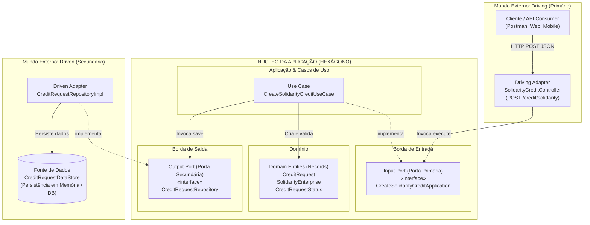

IFRS - Instituto Federal de Educação, Ciência e Tecnologia do Rio Grande do Sul
Campus Rio Grande
Curso Superior de Tecnologia em Análise e Desenvolvimento de Sistemas (TADS)
Disciplina: RGD-PPA005 - Princípios e Padrões de Arquitetura (2026.2 - T01)
Professora: Beatriz da Costa
Aluno: Jaaziel Pinto Machado (Matrícula: 20240018766)
Projeto Integrador: CommuniTracker API
Repositório GitHub: https://github.com/MintoJazz/communi-tracker.api.git
Branch da Entrega: feature/aula-05-arquitetura-hexagonal

================================================================================
RELATÓRIO TEÓRICO E DESCRITIVO DA ATIVIDADE: ARQUITETURA HEXAGONAL
================================================================================

1. INTRODUÇÃO E CONTEXTO DO PROJETO

O CommuniTracker é uma solução de software desenvolvida para apoiar o ecossistema financeiro e operacional de Bancos Comunitários. Sua finalidade essencial é estimular o desenvolvimento socioeconômico em territórios periféricos e de baixa renda, viabilizando a circulação local de riquezas por meio de crédito popular, fomento a empreendimentos coletivos e controle contábil rigoroso fundamentado no método de partidas dobradas.

No contexto acadêmico da disciplina de Princípios e Padrões de Arquitetura, esta atividade tem como foco a aplicação prática dos conceitos de Arquitetura Hexagonal (Ports and Adapters), idealizada por Alistair Cockburn. O desafio proposto consiste em implementar a funcionalidade de "Solicitação de Crédito para Empreendimento Solidário", garantindo que as regras de negócio centrais do banco fiquem completamente blindadas e isoladas de frameworks de entrega (como Spring Boot / Web MVC) e de tecnologias de persistência (como bancos de dados relacionais ou NoSQL).

2. FUNDAMENTAÇÃO DA ARQUITETURA HEXAGONAL (PORTS AND ADAPTERS)

A Arquitetura Hexagonal estabelece que uma aplicação de software deve ser dividida em duas áreas fundamentais: o Núcleo da Aplicação (Inside / Core) e os Detalhes Externos (Outside / Infrastructure).

O Núcleo é composto pelas Entidades de Domínio e pelos Casos de Uso (regras de negócio e orquestração). Ele não conhece detalhes sobre protocolos de rede, HTTP, banco de dados, bibliotecas de serialização JSON ou frameworks. Para que o mundo externo possa interagir com o núcleo, ou para que o núcleo possa consumir serviços externos, são criadas Portas (Ports).

- Portas Primárias (Input / Driving Ports): São contratos (interfaces) que definem o que a aplicação pode fazer. Elas representam a API do caso de uso e são acionadas por Adaptadores Primários (Driving Adapters), tais como controladores HTTP REST, comandos de terminal CLI ou filas de mensageria.
- Portas Secundárias (Output / Driven Ports): São contratos (interfaces) que definem o que a aplicação precisa do meio externo para concluir sua tarefa (por exemplo, salvar dados, emitir notificações ou consultar serviços de crédito). São implementadas por Adaptadores Secundários (Driven Adapters), tais como repositórios de banco de dados, clientes HTTP externos ou drivers de envio de e-mail.

A grande vantagem dessa abordagem para um sistema financeiro como o CommuniTracker é a Inversão de Dependência (DIP): a lógica de negócio do banco comunitário nunca depende de implementações concretas externas. As dependências sempre apontam para dentro do hexágono. Isso confere alta testabilidade (podemos testar 100% das regras sem subir o servidor Spring ou o banco de dados) e enorme manutenibilidade para trocar ou atualizar tecnologias no futuro.

3. MAPEAMENTO DETALHADO DOS 7 ELEMENTOS ARQUITETURAIS NA IMPLEMENTAÇÃO

Em estrito atendimento aos requisitos solicitados pelo professor, a funcionalidade de Solicitação de Crédito Solidário foi desenhada e implementada contendo com clareza os 7 elementos estruturais da Arquitetura Hexagonal:

3.1. Driving Adapter (Adaptador Primário de Entrada)

- Componente: SolidarityCreditController
- Localização: com.example.communitracker.controller.SolidarityCreditController
- Responsabilidade: Atua na borda externa do sistema. É responsável por receber requisições HTTP REST (protocolo externo) enviadas pelo cliente no endpoint POST /credit/solidarity, desserializar o corpo JSON para um objeto de transferência (CreateSolidarityCreditHttpRequest), converter esses dados para o Command neutro da porta primária e invocar a execução da porta de entrada.
- Padrão do Projeto: Segue a política estrita de Resource-Oriented Controllers segregados por rota (string única). O controlador atende com exclusividade a rota string "/credit/solidarity", sem acumular rotas de detalhe ou de outros recursos.
- Retorno: Converte o Result retornado pela aplicação em códigos de status HTTP semânticos (201 Created para sucesso ou 400 Bad Request contendo mensagem amigável em caso de inconsistência).

  3.2. Input Port (Porta Primária de Entrada)

- Componente: CreateSolidarityCreditApplication
- Localização: com.example.communitracker.interfaces.CreateSolidarityCreditApplication
- Responsabilidade: É uma interface pura em Java 21 que define o contrato da operação de solicitar crédito solidário. Ela expõe o método execute(Command command) e o Record neutro Command. Não possui nenhuma dependência do Spring, do servlet container, de anotações HTTP (@PostMapping, @RequestBody) ou de bibliotecas web. Qualquer cliente ou adaptador (seja um controller REST, um teste unitário, uma fila RabbitMQ ou uma interface CLI) pode acionar essa mesma porta primária.

  3.3. Use Case (Caso de Uso da Aplicação)

- Componente: CreateSolidarityCreditUseCase
- Localização: com.example.communitracker.usecase.CreateSolidarityCreditUseCase
- Responsabilidade: Implementa o contrato da porta primária CreateSolidarityCreditApplication. É a classe responsável por orquestrar o fluxo da solicitação de crédito e aplicar as regras de negócio do banco comunitário. Recebe por injeção de dependência exclusivamente a porta secundária de saída (CreditRequestRepository), desconhecendo por completo como ou onde os dados serão persistidos. Se todas as regras forem satisfeitas, instancia as entidades de domínio e comanda a persistência através da porta secundária, retornando um Result previsível.

  3.4. Domain (Domínio e Regras Centrais)

- Componentes:
  - SolidarityEnterprise: Record imutável que representa o empreendimento solidário solicitante, contendo nome, documento/registro comunitário (CNPJ ou CPF do cooperado), localização comunitária (bairro/território) e segmento produtivo de atuação.
  - CreditRequestStatus: Enum que delimita os estados da solicitação no ciclo comunitário (UNDER_ANALYSIS, APPROVED, REJECTED).
  - CreditRequest: Record imutável central que consolida a solicitação de crédito, agregando o empreendimento, o valor solicitado, o número de parcelas, a taxa de juros fixada, a data/hora da requisição, a finalidade produtiva e o status atual.
- Localização: com.example.communitracker.domain.\*
- Responsabilidade: Encapsular as estruturas e invariantes do negócio bancário solidário sem nenhuma dependência de infraestrutura, garantindo imutabilidade através de Java Records.

  3.5. Output Port (Porta Secundária de Saída)

- Componente: CreditRequestRepository
- Localização: com.example.communitracker.interfaces.CreditRequestRepository
- Responsabilidade: É uma interface que declara os contratos que a aplicação necessita para a persistência das solicitações de crédito. Declara operações como save(CreditRequest creditRequest), findById(Long id) e findAll(). Esta porta pertence conceitualmente à fronteira interna da aplicação; quem dita o contrato é o caso de uso, e não o banco de dados.

  3.6. Driven Adapter (Adaptador Secundário de Saída)

- Componente: CreditRequestRepositoryImpl
- Localização: com.example.communitracker.repository.CreditRequestRepositoryImpl
- Responsabilidade: Implementa a interface CreditRequestRepository (a porta secundária). É anotado com @Repository e realiza a adaptação técnica entre o objeto de domínio da aplicação e a fonte de dados real. Ele gera identificadores únicos (autoincremento) de forma sincronizada e gerencia a persistência no DataStore.

  3.7. Fonte de Dados (Database / Storage)

- Componente: CreditRequestDataStore
- Localização: com.example.communitracker.repository.CreditRequestDataStore
- Responsabilidade: Representa o mecanismo de armazenamento de dados. Em consonância com a Tabela de Riscos e a lista de "Decisões Adiadas para Etapas Posteriores" formalizadas na entrega anterior do CommuniTracker (onde a integração do PostgreSQL definitivo com JPA/Hibernate foi propositalmente postergada para permitir validação ágil e desacoplada das regras de negócio), a persistência atual utiliza uma estrutura compartilhada em memória, simulando a base de dados relacional e já pré-populada com registros de empreendimentos para testes práticos.

4. REGRAS DE NEGÓCIO E ADERÊNCIA AOS ASRS (ARCHITECTURALLY SIGNIFICANT REQUIREMENTS)

A implementação prática reflete com rigor as diretrizes e ASRs consolidados no documento de visão do CommuniTracker:

4.1. Cálculo de Juros Travado em 0.0% (ASR Inegociável)
O motor de crédito do CommuniTracker proíbe a cobrança de juros sobre o crédito solidário de fomento comunitário e familiar. No caso de uso CreateSolidarityCreditUseCase, o atributo interestRate é fixado incondicionalmente em BigDecimal.ZERO. Esse valor é blindado em nível de domínio, impedindo que requisições externas ou futuros controladores enviem percentuais de juros abusivos.

4.2. Faixa Operacional do Fundo Rotativo de Crédito Solidário
Para impedir solicitações irrisórias que sobrecarreguem a gestão comunitária, ou solicitações exorbitantes que comprometam o caixa do banco sem aval ampliado, foram estabelecidas duas regras de negócio explícitas:

- Valor mínimo: R$ 100,00.
- Teto máximo: R$ 10.000,00 por solicitação de fomento inicial para capital de giro ou maquinário.

  4.3. Prazo de Parcelamento Sustentável
  O prazo de pagamento foi parametrizado entre o mínimo de 1 mês e o máximo de 24 meses (2 anos), permitindo o retorno gradual do capital ao fundo rotativo para que outros cooperados da comunidade possam usufruir do mesmo recurso.

  4.4. Validação Rigorosa de Vínculo Comunitário e Finalidade Produtiva
  O crédito solidário não é um empréstimo impessoal; ele possui caráter produtivo e territorial. Portanto, o caso de uso rejeita requisições que não informem o nome do empreendimento, o documento/cadastro do responsável, o território atendido, o segmento produtivo (artesanato, reciclagem, agroecologia, culinária, etc.) e a descrição clara da destinação produtiva do capital.

  4.5. Uso do Result Pattern com Sealed Interfaces
  Para evitar o uso de exceções como fluxo de controle (o que tornaria o sistema frágil e lento), o caso de uso retorna a interface selada Result<T>, que pode ser Result.Success<T> ou Result.Failure<T>. O controlador consome esse resultado através de um switch expression exaustivo do Java 21, devolvendo respostas HTTP padronizadas com previsibilidade matemática.

5. FLUXO COMPLETO DA REQUISIÇÃO (CLIENTE AO BANCO DE DADOS)

O percurso de uma requisição de crédito solidário no sistema ocorre no fluxo estrito "de fora para dentro" e "de dentro para fora" da Arquitetura Hexagonal:

1. O cliente (aplicativo mobile ou painel web) envia uma requisição HTTP POST para o endpoint /credit/solidarity com um corpo JSON contendo os dados do empreendimento e da solicitação.
2. O Driving Adapter (SolidarityCreditController) intercepta a requisição, desserializa o JSON no DTO CreateSolidarityCreditHttpRequest e o transforma no Command neutro.
3. O SolidarityCreditController chama a Input Port (CreateSolidarityCreditApplication.execute(command)).
4. O Use Case (CreateSolidarityCreditUseCase) recebe a chamada e executa as validações de domínio (campos obrigatórios, limites de R$ 100,00 a R$ 10.000,00, prazo de 1 a 24 meses).
5. O Use Case monta as entidades de domínio imutáveis SolidarityEnterprise e CreditRequest, carimbando a taxa de juros em 0.0%, status UNDER_ANALYSIS e timestamp atual.
6. O Use Case invoca o método save(...) da Output Port (CreditRequestRepository).
7. O Driven Adapter (CreditRequestRepositoryImpl) recebe a entidade, calcula o próximo identificador atômico e persiste o registro no CreditRequestDataStore (fonte de dados).
8. O registro salvo é devolvido pelo repositório ao caso de uso, que o empacota em um Result.Success<>(savedCreditRequest).
9. O SolidarityCreditController recebe o Result.Success, formata a resposta com status HTTP 201 (Created) e devolve o JSON completo ao cliente. Em caso de inconsistência de dados, um Result.Failure é mapeado imediatamente para HTTP 400 (Bad Request) com o motivo da rejeição.

10. DESENHO ARQUITETURAL EM ARQUITETURA HEXAGONAL

Abaixo é apresentado o desenho arquitetural representativo da funcionalidade, destacando de maneira inequívoca as fronteiras do Hexágono, os Adaptadores de Entrada/Saída, as Portas e a Inversão de Dependência:

Estrutura Textual Resumida para Importação em Ferramentas Gráficas (draw.io / Canva / Excalidraw):

- Driving Adapter: SolidarityCreditController (recebe requisição HTTP)
- Input Port: CreateSolidarityCreditApplication (contrato primário independente)
- Use Case: CreateSolidarityCreditUseCase (regras e orquestração)
- Domain: CreditRequest, SolidarityEnterprise, CreditRequestStatus (entidades puras)
- Output Port: CreditRequestRepository (contrato secundário de persistência)
- Driven Adapter: CreditRequestRepositoryImpl (adaptador de dados)
- Fonte de Dados: CreditRequestDataStore (armazenamento de dados)

7. COBERTURA DE TESTES AUTOMATIZADOS E QUALIDADE DE CÓDIGO

Para assegurar a robustez da solução entregue, foram desenvolvidas baterias completas de testes automatizados com JUnit 5, Mockito e Spring Boot Test (@WebMvcTest):

- Testes Unitários de Caso de Uso (CreateSolidarityCreditUseCaseTest): 11 cenários de teste cobrindo criação com sucesso, taxa de juros 0.0%, rejeição de comandos nulos, validação de campos vazios do empreendimento, controle de limites monetários (mínimo de R$ 100,00 e máximo de R$ 10.000,00), limites de prazo (1 a 24 meses) e obrigatoriedade da finalidade produtiva.
- Testes de Integração do Controlador (SolidarityCreditControllerTest): Validação do contrato HTTP REST via MockMvc, verificando o status HTTP 201 Created para payloads válidos e HTTP 400 Bad Request para violações de negócio.
- Testes do Repositório (CreditRequestRepositoryImplTest): Verificação da correta atribuição de IDs incrementais e persistência íntegra no DataStore.

Todos os testes da aplicação executam com 100% de sucesso através do comando `./gradlew test`.
